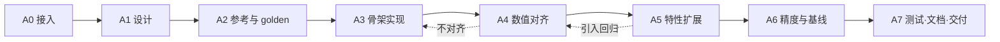

# 工作流：模型适配（ADAPT）

把新模型或新能力接入 SG，交付数值正确、特性声明清晰、代码符合仓库规范的实现。

| 阶段 | 状态 |
| --- | --- |
| A0–A2 | `analyzing` |
| A3–A5 | `implementing` |
| A6 | `validating` |
| A7 | `deciding` |

每个阶段结束运行 `ws gate <ID> --write`，门禁内容见 [gates/adapt.md](../gates/adapt.md)。

---

## A0 接入

**动作**

- 收集模型卡、论文或技术报告、官方参考实现（transformers 或官方仓库）、许可证、权重版本。
- 确认目标 SG 仓库与起点 commit、目标硬件、首版需要的能力。
- 获取权重与参考实现源码并登记。

**产出**：`knowledge/model.md` 中的模型概要；checkpoint 登记；参考实现进入 `worktrees/` 并登记固定 commit。

**本阶段必读**：[asset-intake.md](shared/asset-intake.md)、[source-management.md](shared/source-management.md)。

## A1 设计

**动作**

- 在 SG 中找到**最相近的已支持模型**，作为实现基础与测试参照。
- 逐组件对照参考实现与 SG 已有实现：attention 变体、位置编码、norm、MLP/MoE、embedding 与权重共享、多模态编码器、codec/vocoder、tokenizer/processor/chat template；多阶段引擎还要设计 stage 划分与阶段间数据流。
- 为每个组件决定复用、继承或新增，并写明理由。
- 写权重名映射表（参考 checkpoint 名 → SG 参数名，含合并/拆分关系）。
- 确定首版特性矩阵：每项特性标为“首版支持 / 后续 / 不支持”。

**产出**：`work/<ID>-<name>/design.md`（模板 [design-adapt.md](../templates/design-adapt.md)）。

**本阶段必读**：[references/sglang.md](../references/sglang.md)、多阶段引擎另读 [references/sglang-omni.md](../references/sglang-omni.md)、[references/adapt-handbook.md](../references/adapt-handbook.md)、目标仓库开发者规范。

## A2 参考与 golden

**动作**

- 建立参考实现环境并做快照。
- 固定 prompt 集合（覆盖短/长输入、各模态）、greedy、固定 seed，产出 golden：抽样层 hidden states、logits、生成 token；音频模型另存 codes 与音频。
- 重跑一次确认 golden 可复现；记录 dtype、设备与非确定性来源。

**产出**：`datasets/golden-<model>/<准备版本>/`（清单与生成脚本跟踪，张量按 `.gitignore` 不跟踪）、`validation-results/<ID>/<UTC>-golden-reference/`。

**本阶段必读**：[correctness.md](shared/correctness.md)、[env-setup.md](shared/env-setup.md)。

## A3 骨架实现

**动作**

- 从起点 commit 创建 worktree 与分支。
- 注册模型、解析 config、实现权重加载与前向主干。
- 使用最简配置运行：单卡、BF16、关闭 CUDA graph 和前缀缓存等优化。
- 打印加载时 missing/unexpected 参数并逐条解释，直到无未解释项。

**产出**：可启动、可返回结果的服务；`validation-results/<ID>/<UTC>-load-candidate/`。

**本阶段必读**：目标仓库规范、[references/sglang.md](../references/sglang.md)、[git.md](../conventions/git.md)。

## A4 数值对齐

**动作**

- 用 hook 逐层对比 golden，从第一个超差层开始定位；按 [adapt-handbook.md](../references/adapt-handbook.md#3-对齐排错) 的顺序排查。
- 对比 logits 与 greedy token。
- 对齐工具放在工作区 `scripts/`，不放入目标仓库。

**产出**：对齐报告 `validation-results/<ID>/<UTC>-align-candidate/report.md`（逐层误差表、logits 一致率、greedy 对比）。

**通过标准**：[defaults.md](../conventions/defaults.md#正确性数值对齐适配修复) 中 `corr.*` 口径（或项目覆盖值）。

## A5 特性扩展

**动作**

- 按特性矩阵逐项开启：CUDA graph、前缀缓存、chunked prefill、张量/专家/流水并行、量化、流式、批处理、多模态组合等。
- 每开启一项，回归 A4 的对齐与输出一致性；引入回归时退回 A4 定位。
- 声明不支持的特性须显式报错，不能静默产生错误结果。

**产出**：design.md 特性矩阵逐项填写结果与证据链接；`validation-results/<ID>/<UTC>-feature-candidate/`。

## A6 精度评测与性能基线

**动作**

- 运行 `PROJECT.md` 中的质量套件，与参考实现或官方数字对比。
- 运行性能套件建立基线（项目首个模型即 `OPT-0000` 的输入，可在本项中直接完成并登记）。

**产出**：`benchmark-results/<ID>/` 下的运行与对比；精度对比表写入 item.md。

**通过标准**：`acc.*` 口径。

**本阶段必读**：[benchmark.md](shared/benchmark.md)、[references/benchmarking.md](../references/benchmarking.md)。

## A7 测试、文档与交付

**动作**

- 按目标仓库已有的组织方式补充模型测试（例如与参考实现输出对比的测试）与单元测试，本地运行并留档到 `validation-results/<ID>/<UTC>-unittest-candidate/`。
- 补充模型文档、支持模型列表、示例启动命令。
- 自审后启动独立审查（[code-review.md](shared/code-review.md)），处理意见。
- 按用户指令提交、推送或开 PR（[delivery.md](shared/delivery.md)），复盘（[retro.md](shared/retro.md)）。

**通过标准**：[gates/code-quality.md](../gates/code-quality.md) 全部满足。

## 适配的代码质量要求

- 优先继承或复用已有层与模块，不整段复制已有模型文件；确需复制时在 design.md 说明理由。
- 遵循目标仓库的模型注册、权重加载、并行层、attention backend、多模态 processor 约定，以当前起点 commit 的源码为准。
- 首版只交付特性矩阵中声明的能力。
- 测试沿用仓库已有风格与位置，不另起一套。
- 调试代码（hook、dump、print）不进入最终 diff。
